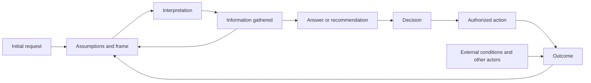

# Why the frame matters

A question selects what counts as relevant evidence, which options are considered, and what a useful answer would mean. A correct answer to the wrong task can still be unhelpful. That does not imply every request has a hidden “real” problem or that a model can discover it without the user's knowledge and context.

## A proposed causal model

This is a design model, not an experimentally established causal chain for this skill. Errors can enter at every transition: a proxy goal selects irrelevant facts; biased evidence supports a false explanation; a sound recommendation meets an unimplemented dependency; external events change the outcome. Good outcomes can also occur by chance. Framing is one intervention point, not a substitute for reliable data, expertise, execution, or outcome measurement.

Simon analyzes problem representation as dependent on goals, available information and operations. Selective-clarification research supports deciding when to ask as a distinct task from generating a question. These are foundations for the design, not validation of this package. See [Simon (1973)](https://www.sciencedirect.com/science/article/pii/0004370273900118), [CLAM (2022)](https://arxiv.org/abs/2212.07769), and [Clarify When Necessary (2023)](https://arxiv.org/abs/2311.09469).

## Different jobs

Retrieval locates relevant existing information. Answer generation communicates a response. Reasoning connects premises to conclusions. Diagnosis compares explanations for observations. Problem discovery tests the representation: objective, cause, scope, affected people, constraints, and available choices. A task may need several of these, or just a direct answer. Question discovery is not intrinsically superior to clarification.

## Information has decision value and a cost

A useful question can reveal an option, reject a premise, distinguish two actions, or show that the original plan remains appropriate. Questions also consume time, attention, privacy and momentum. Qualitatively compare the improvement in the next choice with this burden. Formal value-of-information methods require probabilities and utilities the conversation usually does not supply; do not pretend to compute them. See [Heckerman, Horvitz and Middleton (1993)](https://www.erichorvitz.com/nonmyopevi.htm).

## Discovery can create its own errors

A leading question can plant an explanation. Fluent reframing can replace the user's values. Asking for reasons can invite plausible stories unsupported by observations. Prefer concrete episodes and contrary evidence; offer interpretations provisionally. Human self-reports have limits, but that gives the assistant no authority to invent a better hidden motive. Classic evidence is context-specific: [Loftus and Palmer (1974)](https://doi.org/10.1016/S0022-5371(74)80011-3), [Nisbett and Wilson (1977)](https://doi.org/10.1037/0033-295X.84.3.231).

## Inspiration and limits

The answer 42 in *The Hitchhiker's Guide to the Galaxy* illustrates an answer detached from a known question. It is an analogy, not AI research. User-supplied transcripts attributed to Elon Musk inspired the project direction; their authenticity and transcription accuracy were not established. Their descriptions of AI training do not establish AI consciousness, suffering, or this skill's efficacy. Do not imitate Musk or imply endorsement.

The practical promise is an inspectable question and a better-informed next step. Benefits such as reduced rework or improved decisions remain hypotheses until measured. Keeping a well-supported original question is a success.
